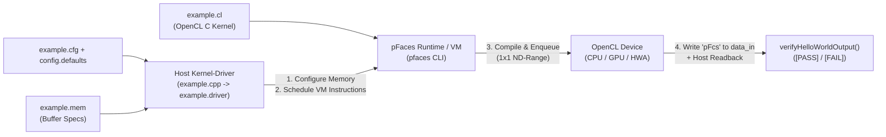

# Lesson 0: Hello World — Anatomy of a pFaces Kernel (`0_HelloWorld`)

> **Learning Series (`0 / 6`)** · Next: [Lesson 1: 1D Vector Addition (SAXPY) →](../1_VectorAdd/README.md)

Every **pFaces** application separates *what* computation runs on an OpenCL device from *how* buffers, device selection, scheduling, and verification are orchestrated on the host. This opening lesson introduces that split using a minimal single-thread `"Hello World"` kernel paired with a 4-byte `"pFcs"` device-to-host handshake.

---

## 1. The Parallel Concept

Before launching thousands of threads (covered in [Lesson 1](../1_VectorAdd/README.md)), you need a mental model of the pFaces execution stack:

1. **Kernel Pack (`kernel-pack/`)**: Pure domain artifacts — OpenCL C device code (`example.cl`), memory-argument metadata (`example.mem`), configuration schema/defaults (`config.template`, `config.defaults`), and per-architecture wrapper stubs (`example.{cpu,gpu,hwa}.cl`).
2. **Kernel-Driver (`kernel-driver/`)**: A C++ shared library (`example.driver`) inheriting `pfaces2DKernel`. It parses configuration keys, injects compile-time macros, allocates device memory, builds an explicit **pFaces Virtual Machine (VM) instruction list**, and verifies the result after execution.
3. **pFaces Runtime (`pfaces`)**: Discovers OpenCL platforms/devices, loads the `.driver` plugin, compiles the `.cl` kernel for the selected target (`cpu`, `gpu`, or `hwa`), executes the VM instruction list, and invokes post-execute verification.



### Thread & Buffer Visualization

This baseline example launches the smallest possible **2D ND-Range**: `1 x 1` work-items (`get_global_id(0) == 0`, `get_global_id(1) == 0`).

```
Host Side                                     OpenCL Device Side (ND-Range: 1 x 1)
----------------------------------------      ----------------------------------------
1. Print host banner via setAsMessage         Work-Item (0, 0):
2. Allocate 4-byte zeroed buffer data_in         - printf("Hello World from the device side!")
                                                 - printf(CFG_MSG), printf(PARAM_MSG)
                                                 - write ground-truth token:
3. Enqueue ReadDeviceBuffer (data_in)  <======     data_in[0..3] = { 'p', 'F', 'c', 's' }
4. BlockingSyncPoint
5. PostExecute: assert data_in == "pFcs"
```

---

## 2. How It Is Implemented in pFaces

### Kernel Side (`kernel-pack/`)

- **[`example.cl`](kernel-pack/example.cl)**: Receives `@pfaces-configValueString:"config_message"` directly from Config4Cpp and `@@param_message@@` injected by the driver, prints them, and writes the 4-byte verification token `"pFcs"`:

```c
#define CFG_MSG @pfaces-configValueString:"config_message"
#define PARAM_MSG @@param_message@@

kernel void exampleKernelFunction(global char* data_in) {
    printf("Hello World from the device side!\n");
    if (get_global_id(0) == 0 && get_global_id(1) == 0) {
        data_in[0] = 'p'; data_in[1] = 'F'; data_in[2] = 'c'; data_in[3] = 's';
    }
}
```

- **[`example.mem`](kernel-pack/example.mem)**: Declares `data_in` using the built-in `pfaces_rw_global` preset, sized as 4 bytes (`baseTypeSize * baseTypeMultiple`) and marked readable by the host (`HostDoRead = "true"`).

```cfg
exampleKernelFunction {
    data_in {
        MemConfig        = "pfaces_rw_global";
        HostDoRead       = "true";
        baseTypeSize     = "1";
        baseTypeMultiple = "4";
        isRangeScalable  = "false";
        isNewOrResident  = "true";
    }
}
```

### Kernel-Driver Side (`kernel-driver/`)

- **[`pFacesExample`](kernel-driver/example.cpp)** constructor: Loads `example.mem`, substitutes `@@param_message@@`, and registers `verifyHelloWorldOutput` via `registerPostExecuteFunction(...)`.
- **`configureParallelProgram(...)`**: Allocates zero-filled memory (`allocateMemory`), records `m_dataPool` buffer index via `getBufferIndex(...)`, and schedules the VM pipeline:

```cpp
parallelProgram.addNetInstruction()->setAsMessage("Hello World from host side !");

auto execJob = std::make_shared<pfacesDeviceExecuteJob>(thisDevice);
execJob->setKernelFunctionIdx(0U, 1U);
execJob->addTask(std::make_shared<pfacesDeviceExecuteTask>(ndKernelOffset, ndKernelRange, ndKernelRange));
parallelProgram.addNetInstruction()->setAsDeviceExecute(execJob);

auto readJob = std::make_shared<pfacesDeviceReadJob>(thisDevice, 0U, 1U, 0U);
parallelProgram.addNetInstruction()->setAsReadDeviceBuffer(readJob);
parallelProgram.addNetInstruction()->setAsBlockingSyncPoint();
```

### Ground-Truth Verification

After the VM finishes, `verifyHelloWorldOutput` checks that the host copy of `data_in` in `program.m_dataPool` matches `{'p', 'F', 'c', 's'}`. Any mismatch prints `[FAIL] 0_HelloWorld: ...` and throws `std::runtime_error` (causing `pfaces` to exit with a non-zero code).

---

## 3. Compile & Test

Requires `PFACES_SDK_ROOT` set and `pfaces` on `PATH` (see root [README](../README.md)).

### Build the Driver

```sh
sh build.sh          # Linux / macOS (writes kernel-pack/example.driver)
```

On Windows: `build.bat`.

### Run All Verification Cases

```sh
sh test.sh           # Runs default config, -p -cfg example.cfg, and -p -hm -cfg example.cfg
```

Or run individual `pfaces` commands directly:

```sh
pfaces -CG -d 1 -k example -v0
pfaces -CG -d 1 -p -k example -cfg example.cfg
pfaces -CG -d 1 -p -hm -k example -cfg example.cfg
```

Expected verification line on each run:

```text
[PASS] 0_HelloWorld: device->host handshake verified ("pFcs")
```

---

> **Next Step**: Continue to [**Lesson 1: 1D Vector Addition (`1_VectorAdd`)**](../1_VectorAdd/README.md) to scale from 1 thread to tens of thousands of element-wise threads and manage host/device buffer transfers (`-hm`).
