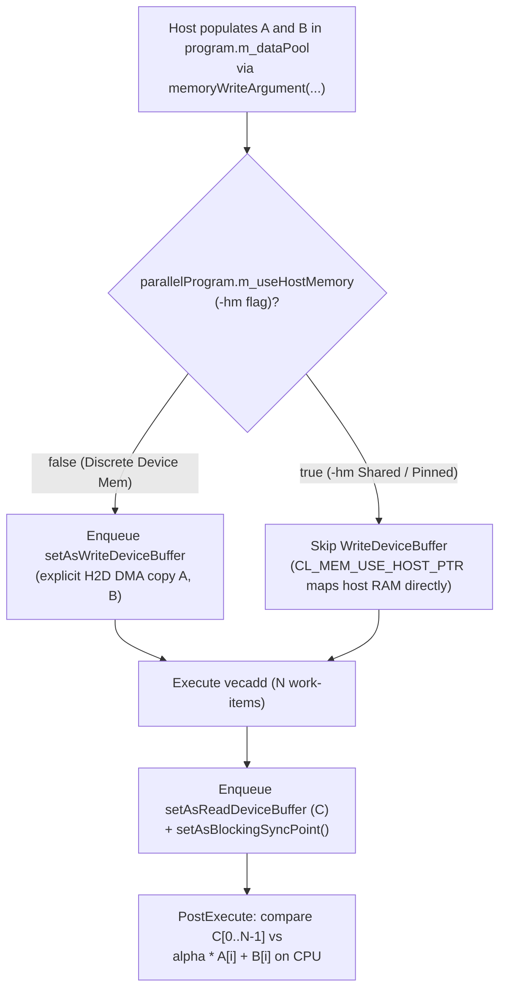

# Lesson 1: 1D Vector Addition — SAXPY & Memory Models (`1_VectorAdd`)

> **Learning Series (`1 / 6`)** · Previous: [← Lesson 0: Hello World](../0_HelloWorld/README.md) · Next: [Lesson 2: Tiled Matrix Multiplication →](../2_MatrixMul/README.md)

**Builds on [Lesson 0](../0_HelloWorld/README.md)**: Moves from a `1 x 1` diagnostic thread to `N` concurrent 1D work-items, demonstrates `isRangeScalable = "true"` automatic buffer scaling, and shows how to write input buffers cleanly under both discrete device memory and `-hm` host-pinned shared memory.

---

## 1. The Parallel Concept

Vector **SAXPY** (*Single-Precision `A * X + Y`*) computes element-wise:

$$C[i] = \alpha \cdot A[i] + B[i], \qquad i \in \{0, 1, \dots, N - 1\}$$

Because every output index $i$ depends **only** on $A[i]$ and $B[i]$ (zero cross-thread dependencies), all $N$ operations are embarrassingly parallel: one OpenCL work-item is assigned per vector element.

### Thread-to-Element Mapping (`get_global_id(0)`)

```
Global 1D ND-Range (size N):
  Work-Item:   gid=0       gid=1       gid=2      ...     gid=N-1
                 |           |           |                   |
                 v           v           v                   v
Input A:     [  A[0]  ]  [  A[1]  ]  [  A[2]  ]   ...   [ A[N-1] ]   (Read-Only Usage)
                 *           *           *                   *   (alpha scalar macro)
                 +           +           +                   +
Input B:     [  B[0]  ]  [  B[1]  ]  [  B[2]  ]   ...   [ B[N-1] ]   (Read-Only Usage)
                 |           |           |                   |
                 v           v           v                   v
Output C:    [  C[0]  ]  [  C[1]  ]  [  C[2]  ]   ...   [ C[N-1] ]   (Read back to Host)
```

### Memory Model: Discrete Device Buffers vs `-hm` Host-Pinned Memory

In OpenCL / pFaces, buffers behave differently depending on whether the user passes `-hm`:



---

## 2. How It Is Implemented in pFaces

### Kernel Side (`kernel-pack/`)

- **[`vecadd.cl`](kernel-pack/vecadd.cl)**: Each work-item reads its 1D global ID (`get_global_id(0)`), checks bounds against `VEC_N`, and computes one element of `C`:

```c
#define VEC_N @@VEC_N@@
#define VEC_ALPHA @@VEC_ALPHA@@

kernel void vecadd(global const float* A, global const float* B, global float* C) {
    const size_t gid = get_global_id(0);
    if (gid < (size_t)VEC_N) {
        C[gid] = ((float)(VEC_ALPHA)) * A[gid] + B[gid];
    }
}
```

- **[`vecadd.mem`](kernel-pack/vecadd.mem)**: Sets `baseTypeSize = "4"` (`float`) and **`isRangeScalable = "true"`** so calling `allocateMemory(..., n, ...)` in C++ automatically sizes `A`, `B`, and `C` to `4 * n` bytes! Also configures `HostDoWrite = "true"` on `A`/`B` and `HostDoRead = "true"` on `C`.

### Kernel-Driver Side (`kernel-driver/`)

- **[`VectorAddKernel`](kernel-driver/vecadd.cpp)** constructor: Reads `vector_size` (`32768` default, `131072` in `example.cfg`) and `alpha` (`1.75` default, `2.5` in `example.cfg`), calls `setDimensions(length, 1U)`, and injects `@@VEC_N@@` + `@@VEC_ALPHA@@` via `updateParameters(...)`.
- **`configureParallelProgram(...)`**: Allocates buffers (`numInstances = n`), initializes `A` and `B` using `memoryWriteArgument`, conditionally skips `setAsWriteDeviceBuffer` when `m_useHostMemory` is enabled, executes `vecadd` with `cl::NullRange` local size (letting OpenCL choose the work-group size), and reads `C` back:

```cpp
allocateMemory(parallelProgram.m_dataPool, thisMachine, {thisDeviceIdx}, n, false);
memoryWriteArgument(parallelProgram.m_dataPool, 0U, 0U, reinterpret_cast<const char*>(initA.data()), nBytes, 0U);
memoryWriteArgument(parallelProgram.m_dataPool, 0U, 1U, reinterpret_cast<const char*>(initB.data()), nBytes, 0U);

if (!parallelProgram.m_useHostMemory) {
  for (size_t argIdx : {0U, 1U}) {
    auto writeJob = std::make_shared<pfacesDeviceWriteJob>(thisDevice, 0U, 3U, argIdx);
    parallelProgram.addNetInstruction()->setAsWriteDeviceBuffer(writeJob);
  }
}
```

### Ground-Truth Verification

`verifyVecAddOutput` computes `alpha * A[i] + B[i]` on the CPU for every index `0..N-1`, tracks `max_abs_err`, and fails with a non-zero exit code if any element exceeds `1e-5f`.

---

## 3. Compile & Test

```sh
sh build.sh          # Compiles kernel-driver/vecadd.cpp -> kernel-pack/vecadd.driver
sh test.sh           # Runs default, -p -cfg example.cfg, and -p -hm -cfg example.cfg
```

(Windows: `build.bat` and `test.bat`.)

Example output:

```text
[PASS] 1_VectorAdd (SAXPY): N=32768, alpha=1.75, max_abs_err=0.000e+00
[PASS] 1_VectorAdd (SAXPY): N=131072, alpha=2.50, max_abs_err=0.000e+00
```

---

> **Next Step**: Continue to [**Lesson 2: Tiled Matrix Multiplication (`2_MatrixMul`)**](../2_MatrixMul/README.md) to work with **2D ND-Ranges**, cooperative **`__local` shared memory**, and **on-the-fly `-t` tuning**.
