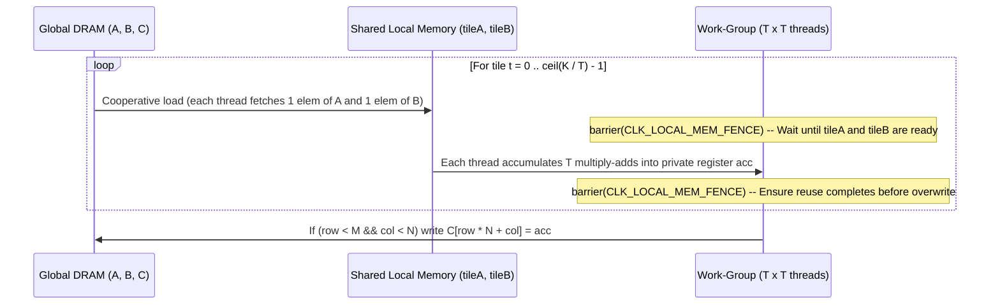

# Lesson 2: 2D Tiled Matrix Multiplication (`2_MatrixMul`)

> **Learning Series (`2 / 6`)** · Previous: [← Lesson 1: Vector Addition](../1_VectorAdd/README.md) · Next: [Lesson 3: Parallel Reduction →](../3_ParallelReduction/README.md)

**Builds on [Lesson 1](../1_VectorAdd/README.md)**: Transitions from independent 1D threads in global memory to **2D thread grids** where work-items within a work-group cooperate through fast **`__local` shared memory** (`barrier(CLK_LOCAL_MEM_FENCE)`), dynamic C++ buffer sizing (`isRangeScalable = "false"`), and pFaces auto-tuning (`-t`).

---

## 1. The Parallel Concept

For dense matrix multiplication $C = A \times B$ where $A$ is $M \times K$, $B$ is $K \times N$, and $C$ is $M \times N$:

$$C[row, col] = \sum_{k=0}^{K-1} A[row, k] \cdot B[k, col]$$

A naive GPU implementation assigns one thread per output element $C[row, col]$ and fetches a full row of $A$ and column of $B$ directly from global DRAM — loading $2K$ floats from slow off-chip memory for every single cell ($2MNK$ total global loads).

**Tiled Shared-Memory GEMM** partitions $C$ into $T \times T$ output sub-blocks (`TILE_SIZE = 16`) and marches across $K$ in phases $t = 0, \dots, \lceil K/T \rceil - 1$. In each phase, all $T^2$ threads in a work-group cooperatively load **one $T \times T$ tile of $A$** and **one $T \times T$ tile of $B$** into fast on-chip `__local` memory, synchronize with a barrier, and reuse every loaded element $T$ times before moving to the next tile — cutting global memory traffic by a factor of **$T = 16\times$**.

### 2D Tiling Visualization

```
             col = get_global_id(0) (0..N-1)
                      |
                      v
        B (K x N):   +---------+
        phase t  --> | tileB   |  <-- loaded cooperatively into local float tileB[T][T]
                     +---------+
                          |
                          v   dot-product across k = 0..T-1
A (M x K):           +---------+
row =     +-------+  |  C tile |  Work-group (T x T) computes partial sums in registers:
global(1) | tileA |  | (row,   |    acc += tileA[ly][k] * tileB[k][lx]
          +-------+  |  col)   |
              ^      +---------+
              |
    phase t loads local float tileA[T][T] (zero-padded when row >= M, tiledCol >= K)
```

### Two-Barrier Work-Group Execution Flow



---

## 2. How It Is Implemented in pFaces

### Kernel Side (`kernel-pack/`)

- **[`matmul.cl`](kernel-pack/matmul.cl)**: Declares static `__local float tileA[TILE_SIZE][TILE_SIZE]` and `tileB`, guards rectangular (non-multiple-of-`TILE_SIZE`) boundaries by substituting `0.0f`, and synchronizes twice per $K$-tile:

```c
tileA[ly][lx] = (row < (size_t)MAT_M && tiledCol < (size_t)MAT_K)
    ? A[row * (size_t)MAT_K + tiledCol] : 0.0f;
tileB[ly][lx] = (tiledRow < (size_t)MAT_K && col < (size_t)MAT_N)
    ? B[tiledRow * (size_t)MAT_N + col] : 0.0f;
barrier(CLK_LOCAL_MEM_FENCE);

for (size_t k = 0; k < (size_t)TILE_SIZE; k++) {
    acc += tileA[ly][k] * tileB[k][lx];
}
barrier(CLK_LOCAL_MEM_FENCE);
```

- **[`matmul.mem`](kernel-pack/matmul.mem)**: Unlike `1_VectorAdd` where all three vectors shared length `N`, here $A$ ($M \times K$), $B$ ($K \times N$), and $C$ ($M \times N$) have **different** sizes. So `.mem` sets **`isRangeScalable = "false"`** and `baseTypeMultiple = "1"`, leaving exact element counts to C++.

### Kernel-Driver Side (`kernel-driver/`)

- **[`MatrixMulKernel`](kernel-driver/matmul.cpp)** constructor: Sets custom buffer sizes directly on the loaded fingerprint before `allocateMemory`:

```cpp
auto funcArgs = pfacesKernelFunctionArguments::loadFromFile(memFile, "matmul", {"A", "B", "C"});
funcArgs.m_baseTypeMultiple[0] = m_state->m * m_state->k;
funcArgs.m_baseTypeMultiple[1] = m_state->k * m_state->n;
funcArgs.m_baseTypeMultiple[2] = m_state->m * m_state->n;
```

- **2D Global & Local ND-Range + Device Limit Check**: Pads `global` up to multiples of `tile_size = 16` (`padN x padM`), checks `tileSize^2 <= CL_DEVICE_MAX_WORK_GROUP_SIZE`, and dispatches explicit `(ndGlobal, ndLocal)`.
- **Auto-Tuning Hook (`configureTuneParallelProgram`, invoked by `-t`)**: Builds a lightweight zero-filled tune program with a single `pfacesDeviceExecuteJob` + `setAsBlockingSyncPoint()` so pFaces can benchmark/tune work distribution before running the main program.

### Ground-Truth Verification

`verifyMatMulOutput` evaluates the exact CPU triple-loop $A \times B$ for every `(r, c)` in `0..M-1 x 0..N-1` and fails if any entry exceeds `1e-3f * (1.0f + 0.01f * K)`. Tested both on square `(64x64) * (64x64)` defaults and rectangular `(96x80) * (80x112)` in `example.cfg`.

---

## 3. Compile & Test

```sh
sh build.sh          # Builds kernel-pack/matmul.driver
sh test.sh           # Runs default, -t -p -cfg example.cfg, and -p -hm -cfg example.cfg
```

(Windows: `build.bat` and `test.bat`.)

Example output:

```text
[PASS] 2_MatrixMul: (64x64) * (64x64), tile=16x16, max_abs_err=4.768e-07
[PASS] 2_MatrixMul: (96x80) * (80x112), tile=16x16, max_abs_err=9.537e-07
```

---

> **Next Step**: Continue to [**Lesson 3: Two-Stage Parallel Reduction (`3_ParallelReduction`)**](../3_ParallelReduction/README.md) to learn **tree-based intra-group folding**, **chaining multiple OpenCL kernels** via **resident device buffers**, and **dynamic `__local` allocation in `.mem`**.
