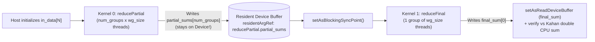

# Lesson 3: Two-Stage Parallel Sum Reduction (`3_ParallelReduction`)

> **Learning Series (`3 / 6`)** · Previous: [← Lesson 2: Matrix Multiplication](../2_MatrixMul/README.md) · Next: [Lesson 4: 2D Heat Stencil & VM Loops →](../4_Stencil2D_Heat/README.md)

**Builds on [Lesson 2](../2_MatrixMul/README.md)**: Moves from matrix element independence to a **many-to-one associative reduction** ($\sum_{i=0}^{N-1} x_i$). Introduces **grid-stride loops** for arbitrary array lengths $N$, **binary tree reductions** in dynamically sized `__local` memory, **chaining multiple OpenCL kernels** (`reducePartial` -> `reduceFinal`), and **resident device buffers** (`residentArgRef`) so intermediate data never touches the host.

---

## 1. The Parallel Concept

Summing $N$ numbers produces a single scalar, so thousands of threads cannot simply write to `final_sum[0]` without severe race hazards or serialization. The standard data-parallel solution performs a **Two-Stage Tree Reduction**:

1. **Grid-Stride Local Pre-Accumulation** (Stage 1): Launch `num_groups` work-groups of `wg_size` threads. Each thread strides across `in_data` at `idx = gid, gid + gsize, ...`, summing into a private register — effortlessly handling arbitrary non-power-of-two `N` (e.g., `100,000`).
2. **Intra-Work-Group Tree Fold**: Threads deposit register sums into `__local float* scratch` (`wg_size` elements) and halve active threads per step (`stride = lsize >> 1; stride >>= 1`), taking only $\log_2(\text{wg\_size})$ steps to collapse each work-group into `partial_sums[grp]`.
3. **Final Consolidation** (Stage 2): A single work-group reads the `num_groups` partial sums into `__local scratch` and runs the same tree fold to produce `final_sum[0]`.

### Thread & Tree Reduction Visualization (`wg_size = 8` illustrated)

```
Grid-Stride Phase (each thread gid loops over idx = gid, gid + gsize, ...):
  in_data[0..N-1]  ===>  localAcc in registers  ===>  scratch[0..7]

Intra-Group Binary Tree Fold in __local scratch[]:
  Step 0 (initial)   : [ s0 ] [ s1 ] [ s2 ] [ s3 ] [ s4 ] [ s5 ] [ s6 ] [ s7 ]
                         \      /      |      |      |      /       /      /
  stride = 4 (lid<4) : [s0+s4] [s1+s5] [s2+s6] [s3+s7]   .      .       .      .
                         \       |      /       /
  stride = 2 (lid<2) : [s0+s2+s4+s6] [s1+s3+s5+s7]
                         \            /
  stride = 1 (lid=0) : [  group_sum  ]  ---> written to partial_sums[grp] (Stage 1)
                                             or final_sum[0]              (Stage 2)
```

### Multi-Kernel Pipeline & Resident Intermediate Buffer



---

## 2. How It Is Implemented in pFaces

### Kernel Side (`kernel-pack/`)

- **[`reduction.cl`](kernel-pack/reduction.cl)**: Implements `reducePartial` and `reduceFinal` taking `local float* scratch` as a dynamic local-memory kernel parameter.
- **[`reduction.mem`](kernel-pack/reduction.mem)**: Demonstrates two crucial `.mem` features:
  1. **Dynamic `__local` allocation (`isLocalMemory = "true"`)**: Tells the pFaces VM not to allocate a host buffer and instead bind `cl::Local(baseTypeSize * baseTypeMultiple)` at launch time (resized in C++ to `wg_size`). Remember `isLocalMemory = "true"` keeps `isNewOrResident = "true"` (default from `pfaces_rw_global`).
  2. **Buffer sharing across kernels (`isNewOrResident = "false"` + `residentArgRef`)**: Links `reduceFinal.partial_sums` straight to `reducePartial.partial_sums` on the device:

```cfg
reducePartial {
    scratch {
        MemConfig = "pfaces_rw_global";
        isGlobalMemory = "false"; isConstantMemory = "false"; isLocalMemory = "true";
        HostDoWrite = "false"; HostDoRead = "false";
        baseTypeSize = "4"; baseTypeMultiple = "64"; isRangeScalable = "false";
    }
}
reduceFinal {
    partial_sums {
        MemConfig = "pfaces_rw_global";
        HostDoWrite = "false"; HostDoRead = "false";
        isNewOrResident = "false";
        residentArgRef = "reducePartial.partial_sums";
    }
}
```

### Kernel-Driver Side (`kernel-driver/`)

- **[`ReductionKernel`](kernel-driver/reduction.cpp)**: Sizes `argsPartial.m_baseTypeMultiple[0] = numElements`, `[1] = numGroups`, and `[2] = wgSize`, checks `isPowerOfTwo(wgSize)` and `numGroups <= wgSize`, then chains `reducePartial` (`kernelFunctionIdx = 0`) -> `setAsBlockingSyncPoint()` -> `reduceFinal` (`kernelFunctionIdx = 1`) -> `setAsReadDeviceBuffer(1U, 3U, 1U)`.
- Uses **`getBufferIndex("reducePartial", "in_data", memReport)`** and **`getBufferIndex("reduceFinal", "final_sum", memReport)`** so the verifier looks up exact slots safely even when resident arguments collapse buffer indices in `m_dataPool`.

### Ground-Truth Verification

Because plain `float` left-to-right summation suffers catastrophic rounding cancellation over $10^5$ elements, `verifyReductionOutput` computes the reference sum using **double-precision Kahan compensated summation** and checks `rel_err <= 1e-4` (observed `~5e-8`). Default uses `N = 65536`, `example.cfg` uses non-power-of-two `N = 100000`.

---

## 3. Compile & Test

```sh
sh build.sh          # Builds kernel-pack/reduction.driver
sh test.sh           # Runs default (N=65536), -p -cfg example.cfg (N=100000), and -p -hm -cfg example.cfg
```

(Windows: `build.bat` and `test.bat`.)

Example output:

```text
[PASS] 3_ParallelReduction: N=65536, device_sum=47830.2969, cpu_sum=47830.2992, rel_err=4.938e-08
[PASS] 3_ParallelReduction: N=100000, device_sum=72996.8438, cpu_sum=72996.8488, rel_err=6.966e-08
```

---

> **Next Step**: Continue to [**Lesson 4: 2D Heat Diffusion Stencil (`4_Stencil2D_Heat`)**](../4_Stencil2D_Heat/README.md) to drive iterative **ping-pong buffers** with **pFaces VM loops (`setAsHostFunction` + `setAsJumpNe`)**.
