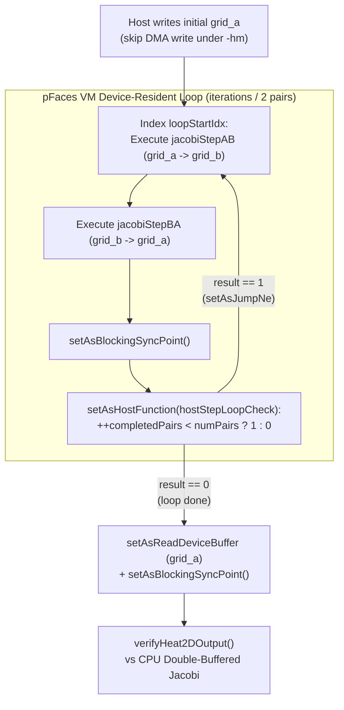

# Lesson 4: 2D Heat Stencil — Ping-Pong Buffers & VM Loops (`4_Stencil2D_Heat`)

> **Learning Series (`4 / 6`)** · Previous: [← Lesson 3: Parallel Reduction](../3_ParallelReduction/README.md) · Next: [Lesson 5: Tiled 3D N-Body →](../5_NBody/README.md)

**Builds on [Lesson 2](../2_MatrixMul/README.md) (2D grids) and [Lesson 3](../3_ParallelReduction/README.md) (resident device buffers)**: Many PDE solvers and cellular automata advance across hundreds of iterations where each cell reads neighbors computed on the *previous* iteration. This lesson shows why updating a buffer in-place causes race conditions, how **ping-pong double buffering** resolves them without host copies, and how to execute fixed-point loops directly inside the **pFaces VM** using `setAsHostFunction` and `setAsJumpNe`.

---

## 1. The Parallel Concept

We solve 2D steady-state heat conduction on a `width x height` plate using explicit 5-point **Jacobi relaxation** with fixed Dirichlet boundaries (`T = 100.0` along the top edge `y = 0`; `T = 0.0` on left, right, bottom edges and initial interior):

$$T^{(t+1)}[y, x] = (1 - 4r)\, T^{(t)}[y, x] + r \left(T^{(t)}[y-1, x] + T^{(t)}[y+1, x] + T^{(t)}[y, x-1] + T^{(t)}[y, x+1]\right)$$

with diffusion stability parameter $r \in (0, 0.25]$.

If all `(x, y)` threads wrote back into the same array they read from, fast work-groups would overwrite neighbors before slow work-groups read iteration $t$. **Ping-pong double buffering** alternates two device-resident arrays (`grid_a` and `grid_b`):

### 2D Grid & 5-Point Stencil Visualization

```
  grid_in (iteration t)                                   grid_out (iteration t+1)
  +-----------------------------------+                   +-----------------------------------+
  | 100  100  100  100  ...      100  | <-- y=0 Top=100   | 100  100  100  100  ...      100  |
  |   0         [N]                0  |                   |   0                          0    |
  |   0   [W]--[ C ]--[E]          0  | === 5-point ===>  |   0        T_out(x, y)       0    |
  |   0         [S]                0  |     weighted      |   0                          0    |
  |   0    0    0    0  ...        0  |     stencil       |   0    0    0    0  ...      0    |
  +-----------------------------------+                   +-----------------------------------+
   y=H-1 Bottom = 0, Left/Right = 0                         Border cells copied unchanged
```

### pFaces VM Loop & Ping-Pong Double Buffering

Each VM loop iteration runs **one pair** of Jacobi steps (`jacobiStepAB` followed by `jacobiStepBA`), so after `iterations / 2` loop pairs the converged temperature field always lands cleanly back in `grid_a`:



---

## 2. How It Is Implemented in pFaces

### Kernel Side (`kernel-pack/`)

- **[`heat2d.cl`](kernel-pack/heat2d.cl)**: Shares one `jacobiStepImpl(grid_in, grid_out)` helper between two `@pfaces`-parameterized kernels (`@@HEAT_WIDTH@@`, `@@HEAT_HEIGHT@@`, `@@HEAT_R@@`). Boundary cells (`x == 0`, `x == w-1`, `y == 0`, `y == h-1`) preserve `grid_in[idx]`, while interior threads evaluate the 5-point stencil.
- **[`heat2d.mem`](kernel-pack/heat2d.mem)**: Wires `jacobiStepBA`'s arguments directly to `jacobiStepAB`'s buffers in reverse via `residentArgRef` so zero extra device memory is allocated or copied between steps:

```cfg
jacobiStepBA {
    grid_in  { isNewOrResident = "false"; residentArgRef = "jacobiStepAB.grid_out"; ... }
    grid_out { isNewOrResident = "false"; residentArgRef = "jacobiStepAB.grid_in";  ... }
}
```

### Kernel-Driver Side (`kernel-driver/`)

- **[`Heat2DKernel`](kernel-driver/heat2d.cpp)**: Records `loopStartIdx = parallelProgram.m_spInstructionList.size()` right before `jacobiStepAB`, then checks the pair counter inside a VM host callback:

```cpp
const size_t loopStartIdx = parallelProgram.m_spInstructionList.size();
// Enqueue stepABJob (func 0) and stepBAJob (func 1)...
parallelProgram.addNetInstruction()->setAsBlockingSyncPoint();
parallelProgram.addNetInstruction()->setAsHostFunction(hostStepLoopCheck, "hostStepLoopCheck");
parallelProgram.addNetInstruction()->setAsJumpNe(loopStartIdx);
```

Notice the two pFaces VM rules satisfied here:
1. A host function must be preceded by `setAsBlockingSyncPoint()` so OpenCL execution completes before the host inspects counters.
2. When `-p` profiling is active, the final instruction in `m_spInstructionList` must be `setAsBlockingSyncPoint()`.

### Ground-Truth Verification

`verifyHeat2DOutput` runs an exact CPU double-buffered Jacobi reference for all `iterations` steps (`100` on `128x128` by default, `200` on `160x128` in `example.cfg`) and fails if `max_abs_err > 1e-4f`.

---

## 3. Compile & Test

```sh
sh build.sh          # Builds kernel-pack/heat2d.driver
sh test.sh           # Runs default, -p -cfg example.cfg, and -p -hm -cfg example.cfg
```

(Windows: `build.bat` and `test.bat`.)

Example output:

```text
[PASS] 4_Stencil2D_Heat: grid=128x128, iters=100, center=(0.0000 vs 0.0000), mean=4.1675, max_abs_err=4.702e-38
[PASS] 4_Stencil2D_Heat: grid=160x128, iters=200, center=(0.0000 vs 0.0000), mean=5.6975, max_abs_err=9.404e-38
```

---

> **Next Step**: Continue to [**Lesson 5: Tiled 3D Gravitational N-Body (`5_NBody`)**](../5_NBody/README.md) to combine **shared-memory tiling**, **vectorized `float4` buffers**, and **VM ping-pong time-stepping**.
