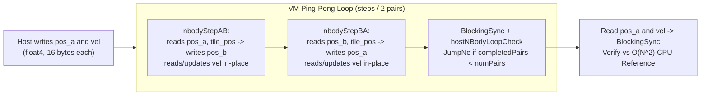

# Lesson 5: Tiled 3D Gravitational N-Body (`5_NBody`)

> **Learning Series (`5 / 6`)** · Previous: [← Lesson 4: 2D Heat Stencil](../4_Stencil2D_Heat/README.md) · Next: [Lesson 6: Privatized Parallel Histogram →](../6_Histogram/README.md)

**Builds on [Lesson 2](../2_MatrixMul/README.md) (`__local` tiling) and [Lesson 4](../4_Stencil2D_Heat/README.md) (VM ping-pong loops)**: Combines 1D shared-memory data reuse, **16-byte packed `float4` vectors** (`baseTypeSize = "16"`), **divergence-safe work-group barriers**, and **VM ping-pong integration** to simulate an $O(N^2)$ gravitational particle cluster.

---

## 1. The Parallel Concept

Every particle $i \in \{0, \dots, N-1\}$ feels the smoothed Newtonian pull of all $N$ bodies in the system:

$$\mathbf{a}_i = \sum_{j=0}^{N-1} \frac{m_j \, (\mathbf{r}_j - \mathbf{r}_i)}{\left(\|\mathbf{r}_j - \mathbf{r}_i\|^2 + \epsilon^2\right)^{3/2}}, \qquad \mathbf{v}_i^{t+\Delta t} = \mathbf{v}_i^t + \mathbf{a}_i \Delta t, \qquad \mathbf{r}_i^{t+\Delta t} = \mathbf{r}_i^t + \mathbf{v}_i^{t+\Delta t} \Delta t$$

Reading all $N$ bodies from global DRAM for each of $N$ threads requires $N^2$ slow global reads per time step. Using **tiled force evaluation** (the 1D analog of `2_MatrixMul`):

- Each work-item holds **its own body** `myPos = pos_in[gid]` in private registers throughout the step.
- Across `numTiles = ceil(N / wgSize)` phases, all threads in a work-group cooperatively load `wgSize` source particles into `__local float4 tile_pos[wgSize]`, hit `barrier(CLK_LOCAL_MEM_FENCE)`, accumulate forces over those cached bodies from fast on-chip memory, and hit a second barrier before loading the next tile — cutting global reads by **`wgSize`x** (`64x`–`128x`).

### All-Pairs Force Tiling & Divergence-Safe Barrier Visualization

```
Work-Group of wgSize threads (thread gid owns body i in registers):

                    tile 0       tile 1           tile (numTiles-1)
  pos_in[0..N-1]: [ j=0..W-1 ] [ j=W..2W-1 ] ... [ j=..., zero-pad if j>=N ]
                       |
                       v   Each thread lid loads 1 float4: pos_in[tile*W + lid]
                  +----------------------------------------+
  __local memory: | tile_pos[0..W-1] (x, y, z, mass)       |
                  +----------------------------------------+
                       |   barrier(CLK_LOCAL_MEM_FENCE) -- ALL threads participate!
                       v
  For k = 0..W-1: thread gid accumulates gravitational force from tile_pos[k] -> acc
  Wait at barrier(CLK_LOCAL_MEM_FENCE), advance tile -> next chunk
  If gid < N: update vel[gid] and write pos_out[gid]
```

> **Why `active` doesn't exit early**: Even when `N` is not a multiple of `wgSize`, padded threads (`gid >= N`) must still execute every `barrier(CLK_LOCAL_MEM_FENCE)` inside the tile loop — otherwise OpenCL behavior is undefined/deadlocks! Here, out-of-range slots load `(float4)(0, 0, 0, 0)` (zero mass -> zero force) and only skip storing results at the end.

### Ping-Pong Buffers (`pos_in` <-> `pos_out`, shared `vel`)



---

## 2. How It Is Implemented in pFaces

### Kernel Side (`kernel-pack/`)

- **[`nbody.cl`](kernel-pack/nbody.cl)**: Packs `(x, y, z, mass)` into `__global float4*` and caches tiles in dynamic `__local float4* tile_pos`. Both `nbodyStepAB` and `nbodyStepBA` call the shared `nbodyStepImpl(...)` inline function.
- **[`nbody.mem`](kernel-pack/nbody.mem)**: Sets `baseTypeSize = "16"` for all `float4` buffers, pairs `isLocalMemory = "true"` on `tile_pos`, and uses `residentArgRef` on `nbodyStepBA` to alias `pos_out` -> `pos_in`, `pos_in` -> `pos_out`, and `vel` -> `vel`.

```cfg
nbodyStepAB {
    pos_in   { MemConfig = "pfaces_rw_global"; HostDoWrite = "true"; HostDoRead = "true"; baseTypeSize = "16"; ... }
    pos_out  { MemConfig = "pfaces_rw_global"; HostDoWrite = "false"; HostDoRead = "false"; baseTypeSize = "16"; ... }
    vel      { MemConfig = "pfaces_rw_global"; HostDoWrite = "true"; HostDoRead = "true"; baseTypeSize = "16"; ... }
    tile_pos { MemConfig = "pfaces_rw_global"; isLocalMemory = "true"; isGlobalMemory = "false"; baseTypeSize = "16"; ... }
}
```

### Kernel-Driver Side (`kernel-driver/`)

- **[`NBodyKernel`](kernel-driver/nbody.cpp)**: Dynamically sets `m_baseTypeMultiple` to `numBodies` for `pos_in`/`pos_out`/`vel` and `wgSize` for `tile_pos` (`16 * wgSize` bytes of shared memory per work-group), initializes a rotating 3D spiral disk, and drives `steps / 2` VM pairs before reading back `pos_a` and `vel` using buffer indices obtained via `getBufferIndex(...)`.

### Ground-Truth Verification

`verifyNBodyOutput` executes a full all-pairs $O(N^2)$ CPU reference simulation for `steps` steps (`N=1024, steps=10` default; `N=2048, steps=16` in `example.cfg`) and verifies both `max_pos_err <= 1e-4f` and `max_vel_err <= 1e-4f`.

---

## 3. Compile & Test

```sh
sh build.sh          # Builds kernel-pack/nbody.driver
sh test.sh           # Runs default (N=1024), -p -cfg example.cfg (N=2048), and -p -hm -cfg example.cfg
```

(Windows: `build.bat` and `test.bat`.)

Example output:

```text
[PASS] 5_NBody: N=1024, steps=10, max_pos_err=2.384e-07, max_vel_err=1.431e-06
[PASS] 5_NBody: N=2048, steps=16, max_pos_err=2.384e-07, max_vel_err=2.861e-06
```

---

> **Next Step**: Continue to [**Lesson 6: Privatized Parallel Histogram (`6_Histogram`)**](../6_Histogram/README.md) to learn how work-group **atomics privatization** eliminates global memory contention on scatter-add workloads.
