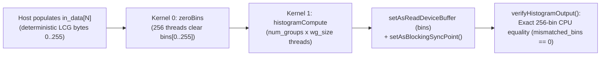

# Lesson 6: Parallel 256-Bin Histogram — Atomics & Privatization (`6_Histogram`)

> **Learning Series (`6 / 6`)** · Previous: [← Lesson 5: Tiled 3D N-Body](../5_NBody/README.md) · Overview: [Series Index →](../README.md)

**Builds on [Lesson 3](../3_ParallelReduction/README.md) (grid-stride multi-kernel chaining) and [Lesson 2](../2_MatrixMul/README.md) / [Lesson 5](../5_NBody/README.md) (`__local` cooperation)**: Every earlier lesson wrote to a **known unique destination index** (a *gather/map* pattern). Histogram computation is a **data-dependent scatter** pattern (`bins[key]++`) where thousands of threads can collide on the same bin simultaneously. This final lesson demonstrates **shared-memory privatization + two-level OpenCL atomics**, plus device-side buffer initialization (`zeroBins`).

---

## 1. The Parallel Concept

Given $N$ byte values $x_0, \dots, x_{N-1} \in \{0, \dots, 255\}$, we want the exact frequency `bins[b]` of each byte value `b`.

- **Why naive global `atomic_inc(&bins[bin])` stalls**: Every thread across the entire GPU/CPU contends on just 256 addresses in off-chip DRAM — serializing execution when hot bins collide.
- **Privatized Work-Group Histogram**: Each work-group maintains its own private 256-bin array `local_bins[256]` (just `1 KiB`) inside fast on-chip `__local` memory and runs in three phases:
  1. **Zero Local Bins**: Collaboratively clear `local_bins[0..255] = 0`, then `barrier(CLK_LOCAL_MEM_FENCE)`.
  2. **Grid-Stride Accumulation**: Each thread loops over `in_data` at `i = gid, gid + totalThreads, ...` and calls **`atomic_inc(&local_bins[in_data[i] & 0xFFU])`** (fast local contention limited to 1 work-group), then `barrier(CLK_LOCAL_MEM_FENCE)`.
  3. **Merge to Global**: Work-items merge non-zero local counts into global DRAM once per bin via **`atomic_add(&bins[b], count)`** — reducing global atomic traffic from $N$ operations down to at most $256 \times \text{num\_groups}$.

### Naive Global Atomics vs Two-Level Privatization

```
Naive:      [ All N threads ] ===( N slow global atomics )===> __global bins[256]

Privatized:
  Work-Group 0: threads --(atomic_inc)--> __local local_bins[256] --\
  Work-Group 1: threads --(atomic_inc)--> __local local_bins[256] ---+--(<= 256*G atomic_add)--> __global bins[256]
  Work-Group G: threads --(atomic_inc)--> __local local_bins[256] --/                                  ^
                                                                                                       |
  Kernel 0 (zeroBins) clears global __global bins[256] = 0 before Kernel 1 runs -----------------------+
```

### Multi-Kernel Execution Pipeline in pFaces



---

## 2. How It Is Implemented in pFaces

### Kernel Side (`kernel-pack/`)

- **[`histogram.cl`](kernel-pack/histogram.cl)**: Separates device reset (`zeroBins`) from computation (`histogramCompute`), using standard OpenCL 1.2 `__local` and `__global` atomics:

```c
for (uint b = lid; b < HIST_BINS; b += wgSize) { local_bins[b] = 0U; }
barrier(CLK_LOCAL_MEM_FENCE);

for (uint i = gid; i < n; i += totalThreads) {
    atomic_inc(&local_bins[in_data[i] & 0xFFU]);
}
barrier(CLK_LOCAL_MEM_FENCE);

for (uint b = lid; b < HIST_BINS; b += wgSize) {
    const uint count = local_bins[b];
    if (count != 0U) { atomic_add(&bins[b], count); }
}
```

- **[`histogram.mem`](kernel-pack/histogram.mem)**: Allocates `bins` (`256` `uint`s) once in `zeroBins` (`HostDoRead = "true"`), shares it via `residentArgRef = "zeroBins.bins"` in `histogramCompute`, and binds `1024`-byte dynamic local scratch (`isLocalMemory = "true"`, `baseTypeMultiple = "256"`).

### Kernel-Driver Side (`kernel-driver/`)

- **[`HistogramKernel`](kernel-driver/histogram.cpp)**: Reads `num_elements` (`262144` default, `524288` in `example.cfg`), `wg_size` (power of 2 <= 256), and `num_groups`; resizes `argsHist.m_baseTypeMultiple[0] = numElements`; populates `in_data` on `funcIdx = 1, argIdx = 0` via `memoryWriteArgument`; enqueues `zeroJob` (`global = 256`) followed by `histJob` (`global = num_groups * wg_size`); and reads back `zeroBins.bins` (`0U, 1U, 0U`).

### Ground-Truth Verification

Integer histograms admit **zero tolerance** for rounding differences. `verifyHistogramOutput` tallies all `num_elements` on the host and asserts `devBins[b] == cpuBins[b]` across all 256 bins and `sum(devBins) == numElements`.

---

## 3. Compile & Test

```sh
sh build.sh          # Builds kernel-pack/histogram.driver
sh test.sh           # Runs default (N=262144), -p -cfg example.cfg (N=524288), and -p -hm -cfg example.cfg
```

(Windows: `build.bat` and `test.bat`.)

Example output:

```text
[PASS] 6_Histogram: N=262144, bins=256, total_count=262144, bin0=1019, mismatched_bins=0
[PASS] 6_Histogram: N=524288, bins=256, total_count=524288, bin0=2008, mismatched_bins=0
```

---

> **Series Complete!** Return to the [**pFacesExamples Curriculum Overview**](../README.md) or review earlier lessons:
> [Lesson 0: Hello World](../0_HelloWorld/README.md) · [Lesson 1: Vector Addition](../1_VectorAdd/README.md) · [Lesson 2: Matrix Multiplication](../2_MatrixMul/README.md) · [Lesson 3: Parallel Reduction](../3_ParallelReduction/README.md) · [Lesson 4: 2D Heat Stencil](../4_Stencil2D_Heat/README.md) · [Lesson 5: 3D N-Body](../5_NBody/README.md)
